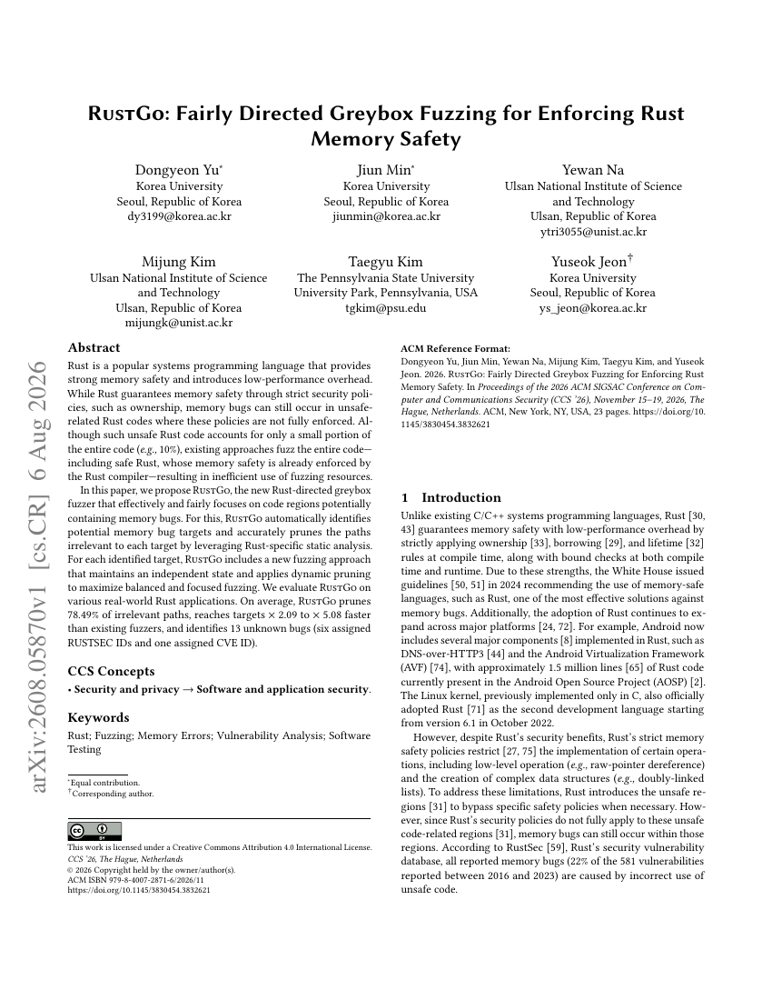

# RustGo: Fairly Directed Greybox Fuzzing for Enforcing Rust Memory Safety

[](https://doi.org/10.1145/3830454.3832621)
[](https://arxiv.org/abs/2608.05870)
[](https://zenodo.org/records/21784601)
[](https://zenodo.org/records/21784601)
[](https://zenodo.org/records/21784601)
[](https://zenodo.org/records/21784601)

<a href="src/paper/RustGo.pdf" target="_blank"></a>

This repository contains the artifact of the paper **RustGo: Fairly Directed Greybox Fuzzing for Enforcing Rust Memory Safety**, accepted at the ACM Conference on Computer and Communications Security (CCS) 2026.

RustGo is a directed greybox fuzzer for Rust. It combines Rust-specific static analysis with a target-aware fuzzing engine.

**Artifact Evaluation.** This artifact passed the CCS 2026 Artifact Evaluation and received all three badges: **Artifacts Available**, **Artifacts Evaluated**, and **Results Reproduced**. The evaluated version is archived on Zenodo: <https://zenodo.org/records/21784601>.

This README explains how to build the artifact and reproduce the main evaluation results. Unless a command block explicitly changes directories, all commands are relative to the repository root.

<br clear="right">


# Getting Started

The experiments in the paper were run on Ubuntu 22.04.5 LTS with Linux 6.8.0, a a 48-core Intel(R) Xeon(R) Platinum 8268 CPU @ 2.90GHz, 565GB of DDR4 RAM.

RustGo is built on:

- `rustc-1.64.0` with LLVM 14.0.6
- SVF 2.4
- AFL++ 4.00c

Large components, especially the Rust compiler, can take a long time to build. We recommend running the setup scripts in a clean shell and keeping the terminal logs for debugging.

# Source Organization

The artifact is organized as follows:

- `build/`: setup and build scripts for the modified Rust compiler, SVF/S2pidy, and the RustGo fuzzing engine. Prebuilt Docker images already contain the outputs under this directory.
- `src/rustc-1.64.0/`: Rust compiler and LLVM patch files used by `rust-1.64.0-build.sh` and `rust-1.64.0-rt-build.sh`.
- `src/SVF-s2pidy/`: RustGo's SVF/S2pidy static-analysis implementation.
- `src/RustGo_stuffs/`: RustGo runtime, AFL++-derived fuzzer changes, LLVM pass sources, and helper scripts.
- `evaluation/compared-fuzzer/`: build scripts for comparison directed greybox fuzzers.
- `evaluation/ablation-variants/`: build scripts for RustGo ablation variants.
- `evaluation/evaluation-artifact/`: benchmark sources, harnesses, and scripts for performance, ablation, DeepSURF, and result summarization.

# Setup Environment of Artifacts

### 1. Environment Setup

Before running evaluation scripts, source the artifact environment in the shell where the experiments will run:

```bash
# Setup RustGo Env
cd env
source env.sh

# Setup Artifacts Env
cd evaluation/evaluation-artifact
source env.sh
```
Run this step again whenever you open a new shell. The script exports paths for the Rust compiler, SVF/S2pidy, RustGo, and the compared fuzzers.

Please set the inital environment for this step before setting the RustGo and building the directed fuzzer, ablation variants and evaluation programs


# How to Use RustGo

Before building RustGo, initialize the artifact environment and common dependencies:

```bash
cd build
./env_init.sh
```

Then build the RustGo toolchain components in the following order.

1. **Build the Rust compiler**

   RustGo uses a modified `rustc-1.64.0` that preserves MIR-level raw-pointer information required by the static analysis.

   ```bash
   cd build
   ./rust-1.64.0-build.sh
   ```

   The first script builds the compiler. The second script builds the compiler runtime and LLVM optimization support used by the evaluation targets.

2. **Build SVF/S2pidy**

   This step builds SVF 2.4 with RustGo's inter-procedural taint analysis and path-pruning analysis. The analysis runs at the LLVM IR level and computes target reachability information used by the fuzzer.

   ```bash
   cd build
   ./s2pidy-build.sh
   ```

3. **Build the RustGo fuzzing engine**

   RustGo extends AFL++ 4.00c with dynamic target toggling, multi-queue scheduling, and target-specific coverage data structures.

   ```bash
   cd build
   ./RustGo-build.sh
   ```

# Install Other DGFs

To reproduce the comparison experiments, install the directed greybox fuzzers (DGFs) ported for the Rust evaluation environment:

```bash
cd evaluation/compared-fuzzer/build
./dgf-init.sh
```

This script prepares the compared fuzzers used in the effectiveness evaluation, including AFLGo, WindRanger, FishFuzz, AFLRun, LyuSo, and PanicKiller.

# Install Ablation Variants

To reproduce the ablation study, install the RustGo variants used to isolate individual design choices:

```bash
cd evaluation/ablation-variants
./variants-init.sh
```

The installed variants correspond to the ablation configurations used under `evaluation/evaluation-artifact/ablation`.

# Evaluation Program Setup

### 1. Program Setup

The performance and ablation benchmarks can be built in bulk from their respective evaluation directories:

```bash
cd evaluation/evaluation-artifact/performance
./performance_init.sh

cd ../ablation
./ablation_init.sh
```

The following fuzzers are used in the RustGo effectiveness evaluation: (We already the fishfuzz for pre-builtin)

```text
afl, aflpp, aflgo, windranger, fishfuzz, aflrun, lyso, panickiller, rustgo
```

The following RustGo variants are used in the ablation study:

```text
dissafe, base, opt, prun, sync
```

The standard performance benchmark contains:

```text
nom, json, serde-yaml, unicode-process, unicode-streaming, data-encoding,
chrono, mqtt-broker, qcms, httparse, quick-xml, lz4_flex, gimli
```

**Individual Build**

If a bulk build fails or is interrupted, rebuild only the affected target from its benchmark directory:

```bash
cd evaluation/evaluation-artifact/performance/[fuzzer]/[program]-src
./build-[fuzzer].sh fuzz
```

For targets that place the fuzzing harness in a nested `fuzz` directory, run the build script from that directory:

```bash
cd evaluation/evaluation-artifact/performance/[fuzzer]/[program]-src/fuzz
./build-[fuzzer].sh fuzz
```

### 2. DeepSURF Benchmark Setup

To configure and build the DeepSURF benchmarks for both performance and ablation experiments, run:

```bash
cd evaluation/evaluation-artifact/deepsurf-benchmark
./deepsurf-benchmark-init.sh
```

**Individual Build**

If one DeepSURF target fails to build, rebuild that target from its `harness` directory:

```bash
cd evaluation/evaluation-artifact/deepsurf-benchmark/performance/[fuzzer]/bug#[num]-[program]/harness
./build-[fuzzer].sh [program]
```

For ablation variants, use the corresponding ablation directory:

```bash
cd evaluation/evaluation-artifact/deepsurf-benchmark/ablation/[variant]/bug#[num]-[program]/harness
./build-[variant].sh [program]
```

Example:

```bash
cd evaluation/evaluation-artifact/deepsurf-benchmark/performance/rustgo/bug#19-ordnung/harness
./build-rustgo.sh ordnung
```

# Reproduce Target Optimization and Path Pruning

After building the benchmark targets with RustGo through `./performance_init.sh`, inspect the two static-analysis outputs used by RustGo: target optimization and path pruning.

The RustGo performance directory includes a summarization script that extracts both measurements for all built targets and writes them in CSV format:

```bash
cd evaluation/evaluation-artifact/performance/rustgo
./summarize_results.sh > rustgo_result.csv
```

The CSV summarizes the following measurements.

1. **Target Optimization**

   RustGo records the optimized targets selected for guided fuzzing in each target's fuzzing directory:

   ```text
   rustgo-fuzz/ToggleInfoNew.txt
   ```

   Each line corresponds to one toggling point selected by RustGo's target-optimization phase. Therefore, the line count of `ToggleInfoNew.txt` is the number of optimized fuzzing targets for that program.

2. **Path-Pruning Rate**

   During RustGo compilation, the static analysis reports the total number of basic blocks and the subset that remains reachable after pruning. RustGo uses those counts to compute the final pruning rate, which appears near the end of each build log:

   ```text
   ****** [Total Pruning Rate] : 87.21% ******
   ```

   This percentage is the fraction of irrelevant control-flow removed from the target-guided search space.

# Effectiveness of RustGo

After building the target programs, reproduce the effectiveness evaluation by running each fuzzer from the corresponding target directory under `performance/<fuzzer>/`.

```bash
cd evaluation/evaluation-artifact/performance/[fuzzer]/[program]-src
./fuzz-[fuzzer].sh
```

For targets whose harness lives in a nested `fuzz` directory:

```bash
cd evaluation/evaluation-artifact/performance/[fuzzer]/[program]-src/fuzz
./fuzz-[fuzzer].sh
```

During execution, each fuzzer attempts to trigger the injected vulnerabilities placed at the target locations. Detection times are written to `reaching-log.txt`, which records when each vulnerable location is reached.

After the performance targets are built, you can run the full performance benchmark with:

```bash
cd evaluation/evaluation-artifact/performance
./run-performance-benchmark.sh
```

For DeepSURF performance experiments, use the corresponding wrappers after `./deepsurf-benchmark-init.sh` completes:

```bash
cd evaluation/evaluation-artifact/deepsurf-benchmark/performance
./run-deepsurf-benchmark.sh
```

# Ablation Study

To evaluate the contribution of individual RustGo components, run the ablation variants from the corresponding target directory under `ablation/<variant>/`.

```bash
cd evaluation/evaluation-artifact/ablation/[variant]/[program]-src
./fuzz-[variant].sh
```

For targets with nested harness directories:

```bash
cd evaluation/evaluation-artifact/ablation/[variant]/[program]-src/fuzz
./fuzz-[variant].sh
```

As in the effectiveness experiments, detection times are recorded in `reaching-log.txt`.

After the ablation targets are built, you can run the full ablation benchmark with:

```bash
cd evaluation/evaluation-artifact/ablation
./run-ablation-benchmark.sh
```

For DeepSURF ablation experiments, use the corresponding wrappers after `./deepsurf-benchmark-init.sh` completes:

```bash
cd evaluation/evaluation-artifact/deepsurf-benchmark/ablation
./run-deepsurf-ablation.sh
```

# FAQ

1. **A compared DGF fails to build. What should I do?**

   Remove the stale build directory for the failed fuzzer and rerun the DGF installation script. Partial compilation artifacts can conflict with a later rebuild, so a clean rebuild is usually more reliable than resuming from a failed state.

   ```bash
   cd evaluation/compared-fuzzer/build
   rm -rf [failed-fuzzer-build-directory]
   ./dgf-init.sh
   ```

2. **The compiler reports `-Wsometimes-uninitialized` as an error while building a fuzzer.**

   Replace the corresponding compiler flag with `-Wno-sometimes-uninitialized` and rebuild. The symptom looks like:

   ```text
   src/afl-fuzz.c:2357:9: error: variable 'orig_afl' is used uninitialized whenever 'if' condition is true [-Werror,-Wsometimes-uninitialized]
       if (afl->stop_soon) { goto stop_fuzzing; }
           ^~~~~~~~~~~~~~
   src/afl-fuzz.c:2793:32: note: uninitialized use occurs here
     restore_orig_afl_state(&afl, orig_afl);
                                  ^~~~~~~~
   src/afl-fuzz.c:2357:5: note: remove the 'if' if its condition is always false
       if (afl->stop_soon) { goto stop_fuzzing; }
       ^~~~~~~~~~~~~~~~~~~~~~~~~~~~~~~~~~~~~~~~~~
   ```


## License

The software components of this artifact are distributed under the GNU Affero General Public License v3.0 or later (AGPL-3.0-or-later).

RustGo builds upon and modifies SVF, which is distributed under AGPL-3.0-or-later. Accordingly, the SVF-derived components and the integrated RustGo software artifact are distributed under the same license terms.

Third-party dependencies retain their original licenses. Please see `THIRD_PARTY_LICENSES.md` for details.


### Third-Party Licenses and Notices (SVF)

This artifact includes and modifies third-party software components. Each third-party component retains its original license.

- Project: SVF-tools/SVF
- License: GNU Affero General Public License v3.0 or later
- Original project: https://github.com/SVF-tools/SVF

RustGo builds upon and modifies SVF for static and pointer analysis components. The original SVF license notices and copyright notices are retained.

Other third-party dependencies retain their original licenses. Please refer to their respective source directories and license files.
